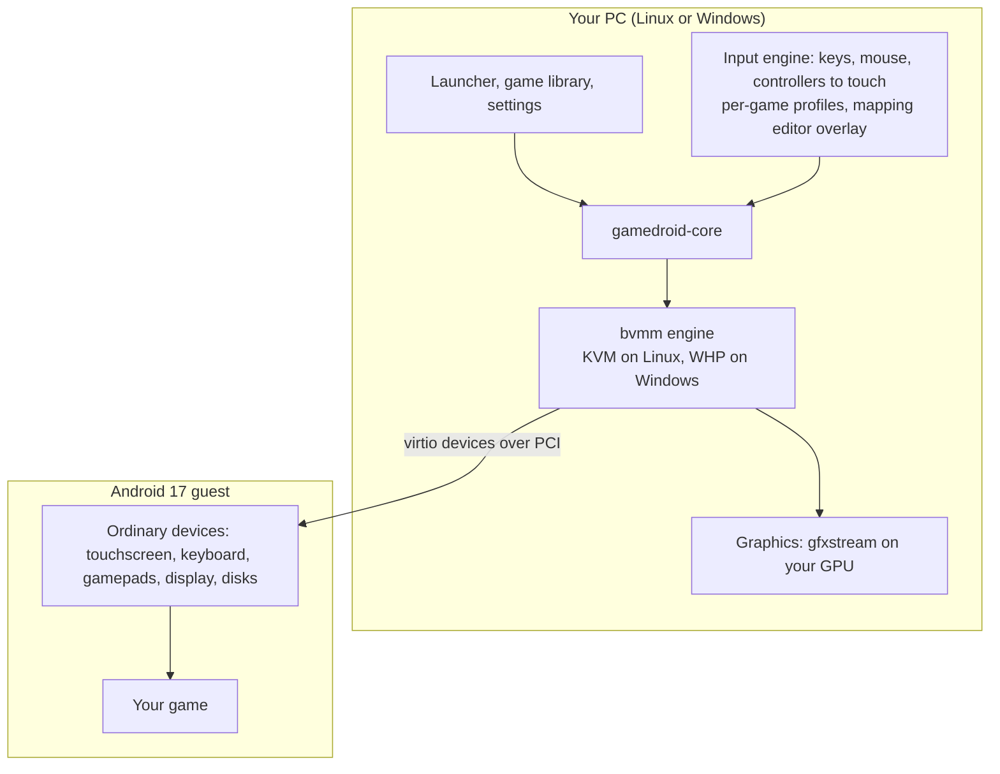

# gameDroid

A free and open source Android emulator for desktop, built for playing games:
keyboard and mouse maps for touch games, real controller support, per-game
profiles, and high frame rates. Linux and Windows. GPLv3 or later.

> **Status, 2026-11-10: early. There is no playable emulator yet.**
> What exists is a design, a chosen engine that boots Linux and Android's own
> kernel on both hosts with a PCI bus and a disk, and a measured checklist of
> what Android needs from it. Everything on this page
> says plainly whether it is working, planned, or a guess.

## Where things stand

| Piece | State |
|---|---|
| Design plan | Written: [docs/DESIGN.md](docs/DESIGN.md) |
| Engine choice | Decided: bvmm, INPUTLOOP's own hypervisor from [bContain](https://github.com/inputloop/bContain). [Decision record](docs/adr/0001-vmm-choice.md) |
| Engine boots a Linux kernel on Linux (KVM) | Working in CI |
| Engine boots a Linux kernel on Windows (WHP) | Working in CI |
| Engine has a PCI bus and a virtio disk | Working in CI on both hosts |
| Android's own kernel boots on the engine | Working in CI on both hosts; on Windows its clock is still coarse |
| Engine boots Android | Not yet. Needs several CPUs, more memory, more devices, and Android's boot sequence |
| A picture on screen | Not yet |
| Touch, keyboard, controller input | Not yet |
| GPU acceleration | Not yet |
| Key mapping editor and game profiles | Not started |

## What you can see today

### The engine booting Linux, on both hosts

bvmm starts a real Linux 6.12 kernel, runs an Alpine container in it, and exits
cleanly. Both runs are from GitHub's CI machines on 2026-11-10
([result notes](docs/engine/results/2026-11-10-E0-kernel-boot.md)).

Linux host, KVM:


Windows host, Windows Hypervisor Platform:


### A disk over PCI, on Windows

Android only accepts its virtual devices on a PCI bus, so the engine now has
one. Here a Linux guest on Windows finds the bus, binds its disk driver, reads
what the host put on the disk and writes something back
([result notes](docs/engine/results/2026-11-10-E1-and-E0b.md)). The same test
passes on Linux.


About these images: the text is copied from the CI job logs
(kept beside the images as `.txt` files) and drawn as a terminal picture by
`tools/screenshots/render-terminal.js`. They are faithful renderings of real
output, not photos of a screen. Lines were left out for length (image pull
progress, unrelated kernel messages); none were altered. The disk image's two
command lines at the top and the host read-back line at the bottom are
annotations describing what the test did.

### The target: stock Android 17 in a virtual machine

This is the Android 17 image gameDroid will run, booted in CI on 2026-11-10
under a different, existing engine (crosvm) to learn what Android expects. It
is a real screenshot taken from inside the guest with `screencap`. It is not
gameDroid's engine and not GPU accelerated: the picture was drawn by the CPU.


Getting this same screen out of bvmm, in a window, is milestone E6.

What that run taught us is written up in
[docs/engine/reference](docs/engine/reference/README.md). The short version:
Android needs its virtual devices on PCI (now built), its kernel cannot use
the Windows timer shortcuts bvmm relies on (confirmed: it boots there with a
coarse clock, fix in progress), and the stock image has no ARM translator.

## How it is meant to work



The idea that makes it a gaming emulator: key and controller mapping happens on
the host. Android only ever sees a normal touchscreen and normal gamepads, so
games behave as they would on a phone, and latency stays low.

## Roadmap

Engine milestones, from [docs/engine/ROADMAP.md](docs/engine/ROADMAP.md):

| # | Milestone | State |
|---|---|---|
| E0 | A real Linux kernel boots on KVM and on WHP | Done in CI. Still to repeat on the Intel reference laptop |
| E0b | Android's own kernel boots on both hosts | Done in CI |
| E0c | That kernel gets a precise clock on Windows | Next |
| E1 | PCI and a virtio disk | Done in CI on both hosts |
| E2 | Several CPUs and large memory | Planned |
| E3 | ACPI and clean power-off | Planned |
| E4 | Network and vsock | Planned |
| E5 | Android boots, no screen | Planned |
| E6 | A picture | Planned |
| E7 | Touch, keys, gamepad | Planned |
| E8 | GPU acceleration | Planned. The hardest item |
| E9 | Sound | Planned |

gameDroid's own features build on these: the playable shell needs E6 and E7,
the mapping editor needs E7, performance work needs E8.

## Things worth knowing before you get excited

- **No GPU acceleration until E8.** Leading with our own engine was a choice;
  the faster route through existing engines was set aside. What that route
  would probably have delivered is recorded as numbered guesses in
  [docs/engine/TRACK1-GUESSES.md](docs/engine/TRACK1-GUESSES.md), and scored as
  results come in (so far: one hit, one miss).
- **Competitive shooters cannot be promised.** Many detect emulators; some ban,
  some put emulator players in their own lobbies. gameDroid will not hide what
  it is or bypass integrity checks. Details in the design plan, section 8.
- **ARM-only games need a translator the stock image does not have.** Google
  apps and ARM translation will be an opt-in step the user performs, offered
  only where the license allows.
- **No custom Android build yet.** There is no build machine for one, so work
  starts from Google's prebuilt Cuttlefish images.

## Try what exists

Check whether a machine is ready (read-only, installs nothing):

```bash
tools/hwtest/probe.sh
```

```powershell
powershell -ExecutionPolicy Bypass -File tools\hwtest\probe.ps1
```

Run the engine yourself, using a [bContain](https://github.com/inputloop/bContain) build:

```bash
bcontain hypervisor-test
```

```bash
bcontain kernel fetch
```

```bash
bcontain run --engine native alpine:3.20 -- uname -a
```

## Repository map

| Path | What is there |
|---|---|
| [docs/DESIGN.md](docs/DESIGN.md) | The design plan: survey of existing emulators, architecture, input design, anti-cheat position, license notes |
| [docs/adr/](docs/adr/) | Decision records |
| [docs/engine/](docs/engine/) | Engine roadmap, results, the Android reference capture, the kept guesses |
| [docs/phase0/](docs/phase0/) | The first round of experiments with existing engines, now closed |
| [docs/screenshots/](docs/screenshots/) | Images used on this page, with their source text |
| [tools/hwtest/](tools/hwtest/) | Scripts to run on real hardware |
| [tools/engine/](tools/engine/) | Helpers for engine tests, such as taking the kernel out of an Android boot image |
| [.github/workflows/](.github/workflows/) | CI: `engine-bvmm` (Linux boot), `engine-disk` (PCI and virtio disk), `engine-gki` (Android's kernel), `engine-android-oracle` (Android reference capture), and parked phase 0 jobs |

## How this project is built

One AI coding agent does the building; the owner runs anything that needs real
hardware. The agent has no GPU and no hypervisor of its own, so:

- Anything about booting a VM is proven on GitHub's CI machines, which have
  KVM and the Windows hypervisor.
- Anything about graphics, frame rate or latency is proven only on the owner's
  RTX 3080 Ti laptop, with a result file handed back.
- Every claim in the docs is labelled by how it was checked: read, built, or
  seen running. Guesses are labelled as guesses.

## Keeping this page honest

This README is updated in the same change as anything it describes. Screenshots
are real output or labelled renderings of it; none are mock-ups. If a section
here disagrees with the repository, the repository is right and this page has
a bug.

## License

GPL-3.0-or-later. See [COPYING](COPYING). The engine, bvmm, lives in bContain
under GPL-3.0-or-later OR LGPL-3.0-or-later.
