# gameDroid

A free and open source Android emulator for desktop, built for playing games:
keyboard and mouse maps for touch games, real controller support, per-game
profiles, and high frame rates. Linux and Windows. GPLv3 or later.

> **Status, 2026-11-10: on Linux, Android boots, takes touch, and runs a real
> game, slowly. It is not yet something you can download and play.** There is
> a window but it has not been tried with Android behind it; drawing is done by
> the CPU; and Windows, which is the target for the finished single-file
> program, cannot boot Android yet. Everything on this page says plainly
> whether it is working, planned, or a guess.

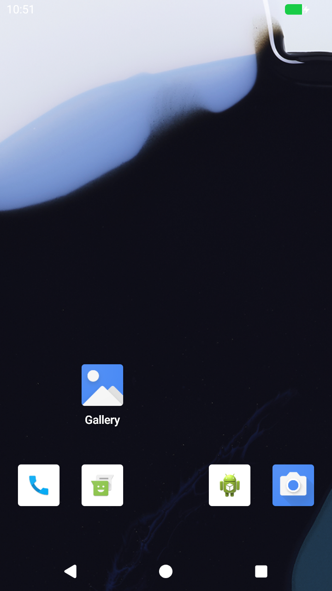

*Stock Android 17 on gameDroid's engine, 2026-11-10: the home screen, reached
by a swipe sent from the host. A real frame read from the engine's display
device in CI. More below.*

## Where things stand

| Piece | State |
|---|---|
| Design plan | Written: [docs/DESIGN.md](docs/DESIGN.md) |
| Engine choice | Decided: bvmm, INPUTLOOP's own hypervisor from [bContain](https://github.com/inputloop/bContain). [Decision record](docs/adr/0001-vmm-choice.md) |
| Engine boots a Linux kernel on Linux (KVM) | Working in CI |
| Engine boots a Linux kernel on Windows (WHP) | Working in CI |
| Engine has a PCI bus and a virtio disk | Working in CI on both hosts |
| Several processors and more than 4 GiB of memory | Working in CI on both hosts. The number of processors follows the host: half its logical processors, between 2 and 8 |
| Android's own kernel boots on the engine | Working in CI on both hosts, with a precise clock on both (on Windows since 2026-11-11) |
| Stock Android 17 boots to its lock screen | Working in CI on Linux (about 40 seconds on two shared cores) and on Windows (about 75 seconds on one) |
| A picture from Android | Working on Linux: frames are read from the engine's display device. Drawn by the CPU; saved to files, there is no window yet |
| Touch input reaches Android | Working on Linux: swipes sent from the host unlock the screen and open the app drawer |
| Installing and starting a game | Working in CI on Linux and Windows: an APK is handed over on a second disk, installed from Android's shell, and started. Shattered Pixel Dungeon reaches its title screen |
| Commands inside Android | Working on Linux, through the image's root shell on the serial port. No adb yet |
| A window | Working in CI on Linux and Windows with Android behind it. On Linux a real mouse swipe in the window unlocks Android. Game mode (keys and mouse following a profile) is checked against a test card only, not yet against a real game |
| Keyboard, controllers | A keyboard device exists and Android sees it; not yet exercised with Android. No controller device yet |
| Android on Windows | Working in CI: boots on two processors with a precise clock, unlocks by touch, installs the game and brings it to the front. Not yet run on a real Windows machine with a GPU |
| Internet in Android | Working in CI on both hosts: Android joins a virtual Wi-Fi backed by a NAT built into the engine (no driver or administrator rights needed), and Android's own internet check passes. IPv4 only, no incoming connections ([results](docs/engine/results/2026-11-11-network.md)) |
| GPU acceleration | Working in CI on Linux: Android draws through gfxstream on the host, and the app turns this on by itself when the graphics library it carries is shown to work (tried first in a separate process; a start that never boots is not repeated unasked; `--gpu on/off` overrides). CI has no GPU, so this proves the path, not the speed. Not yet run on Windows or on a real GPU ([plan and results](docs/engine/E8-gpu-plan.md)) |
| Input engine: game profiles; keys to taps, a virtual joystick, mouse look | Started in `core/input`, tested on its own; not yet connected to the running Android |
| One file that downloads Android, sets it up and starts it | Working in CI on both hosts: `gamedroid.exe` (3 MB, needs nothing installed) and a Linux binary. Started with no arguments it asks where to keep Android and how much room games may use, downloads Android (1.2 GB, checked against a pinned SHA-256, continued if interrupted), prepares it (under 20 seconds), boots it and shows it in its window. Not yet run on a real machine outside CI ([decision](docs/adr/0002-single-file.md)) |
| A help page, and a real browser | Working in CI on Linux. On first run gameDroid fetches Firefox (as Fennec, the free-software build from F-Droid, 128 MB, checked against a fixed SHA-256), installs it, makes it Android's default browser, skips its welcome screens and shows "How to use this browser and OS" as its first page. Firefox opens no files on the phone, so the page is served by the machine's own gateway at `http://10.0.2.2/help.html`, with or without internet. F3 in the window opens the page. Without internet at first run, Android keeps its stock test browser, which gets the page too |
| Sound and microphone | Android has a sound card and plays into it (CI). The app connects the computer's speakers and, only while Android records, a microphone (`--microphone`, `--list-microphones`). No real device has been heard yet: CI has none |
| Camera | Android has one camera, backed by the engine (CI): its camera app shows gameDroid's test picture, live. The app puts the computer's webcam behind it, opened only while Android's camera is in use (`--camera`, `--list-cameras`). No real webcam has been used yet: CI has none |
| Firefox | Looked into. F-Droid's free build of Firefox (Fennec) has an x86-64 release; it installs and starts on gameDroid (CI). How to offer it is undecided ([notes](docs/research/firefox.md)) |
| Linphone (voice calls) as an app gameDroid offers | Decided. Steps 1 and 2 of 5 done in CI: an x86-64 build made from Linphone's source installs and starts on gameDroid, and Android has a network. Calls still need sound and a microphone in the guest ([notes](docs/research/linphone.md)) |
| A launcher, a game library | Not started |
| Key mapping editor | Not started |

## What you can see today

### Android 17 running on gameDroid's engine

Unmodified stock Android 17 (Google's `aosp_cf_x86_64_only_phone` image),
started by `gamedroid-run` on the bvmm engine under KVM. These three frames
are from one CI run on 2026-11-10: the lock screen about 50 seconds after
power-on, the home screen after a swipe up sent from the host, and the app
drawer after a second swipe
([what it took](docs/engine/results/2026-11-10-E5-E6-android-boots.md)).

| Lock screen | After one swipe | After a second swipe |
|---|---|---|
|  |  | 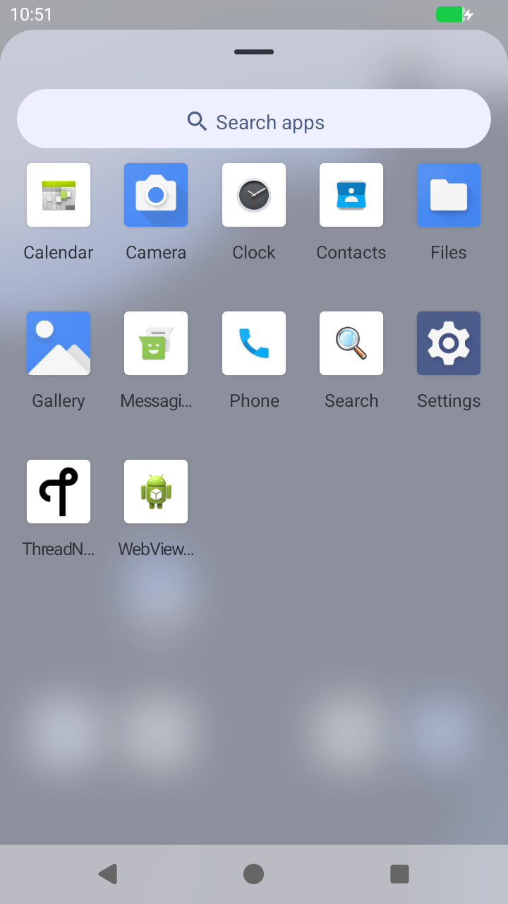 |

### The single file, on a Windows desktop

`gamedroid.exe`, started with no arguments on a clean Windows machine (a CI
runner), a little over a minute after the download: Android's lock screen in
its window.

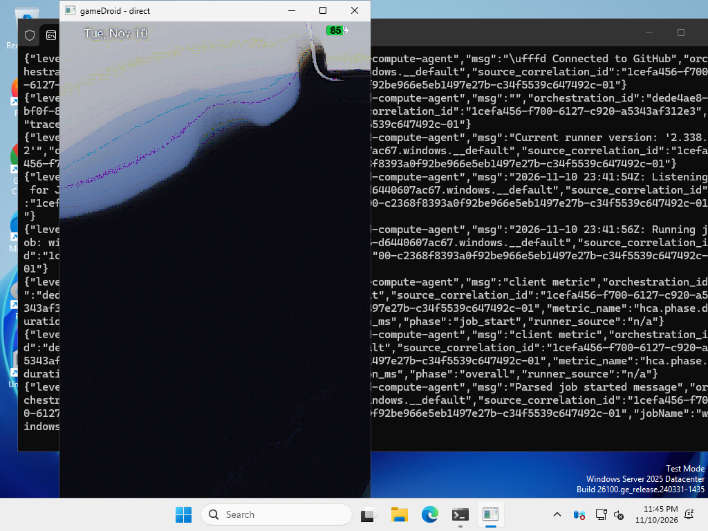

The same on Linux, after a mouse swipe unlocked it:

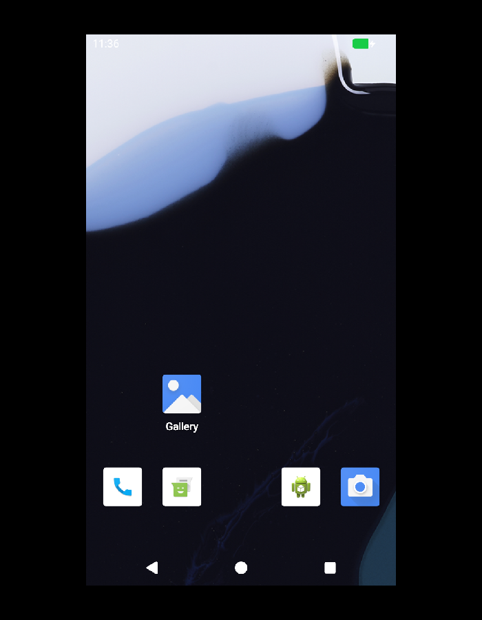

### The help page, inside Android

"How to use this browser and OS". Left: in Firefox (Fennec), which
gameDroid sets up, as its first page. Right: in the stock
image's test browser (CI):

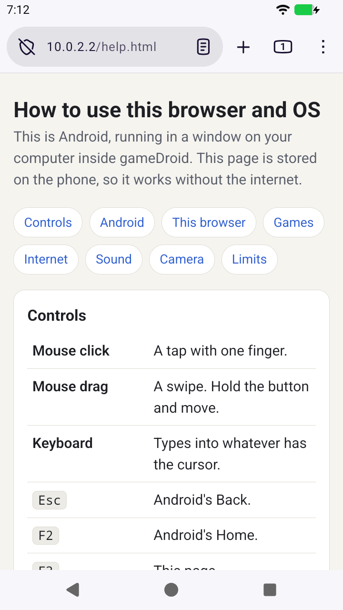 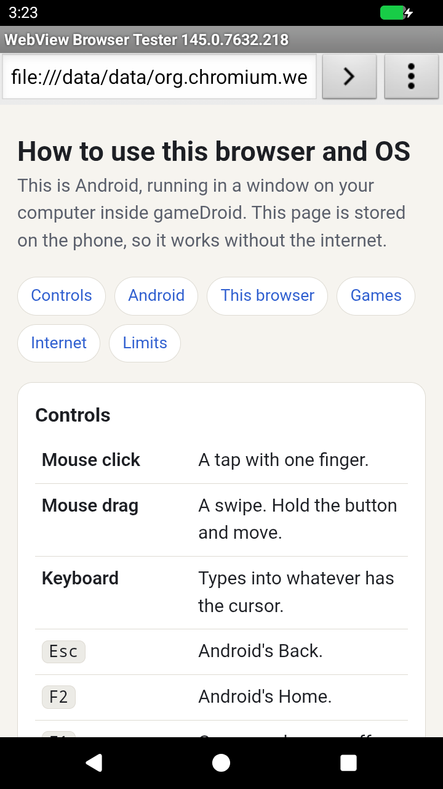

### Android on Windows

The same image and the same game on a Windows host, through the Windows
Hypervisor Platform, set up from nothing by `gamedroid-run --setup`
(CI, no GPU):

 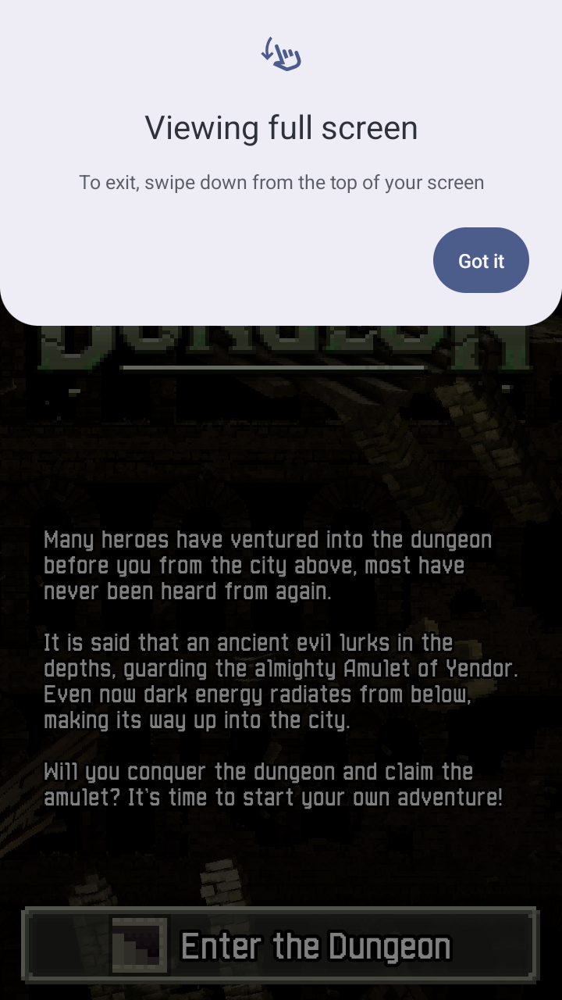

### A game

Shattered Pixel Dungeon (free software, GPLv3, from F-Droid), installed and
started by `gamedroid-run` in CI on 2026-11-10. The notice at the top is
Android's own, shown the first time an app goes full screen.

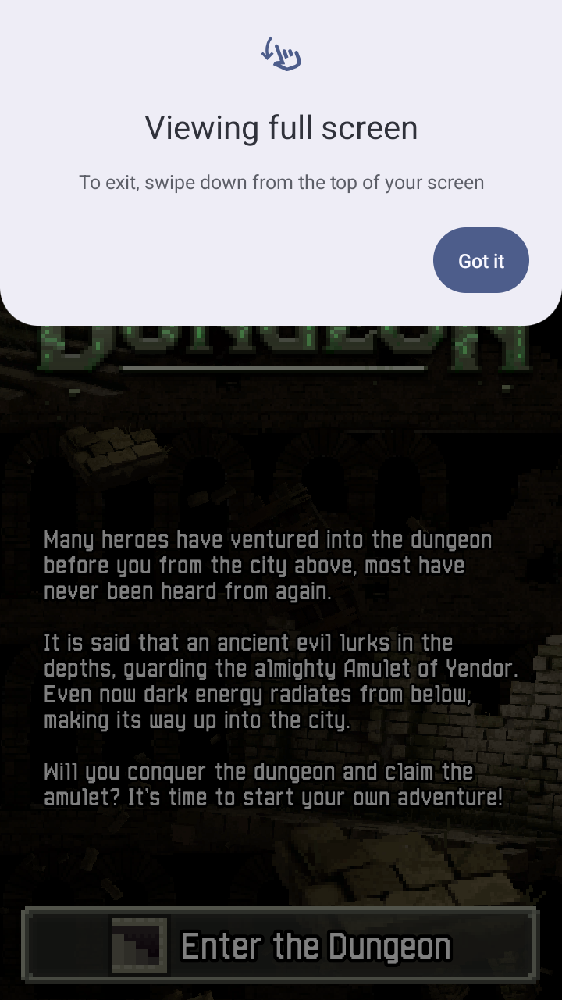

All of these are real frames, read from the engine's display device and saved by
the runner; nothing was drawn or edited. Two honest notes: Android draws them
with the CPU, since there is no GPU acceleration yet, and the runner corrects
the colour order, because this Android image writes red and blue the other way
round from what it tells the display.

### The engine booting Linux, on both hosts

bvmm starts a real Linux 6.12 kernel, runs an Alpine container in it, and exits
cleanly. Both runs are from GitHub's CI machines on 2026-11-10
([result notes](docs/engine/results/2026-11-10-E0-kernel-boot.md)).

Linux host, KVM:

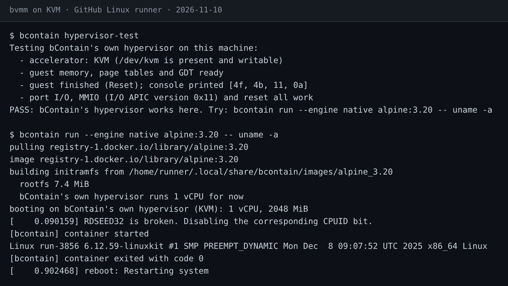

Windows host, Windows Hypervisor Platform:

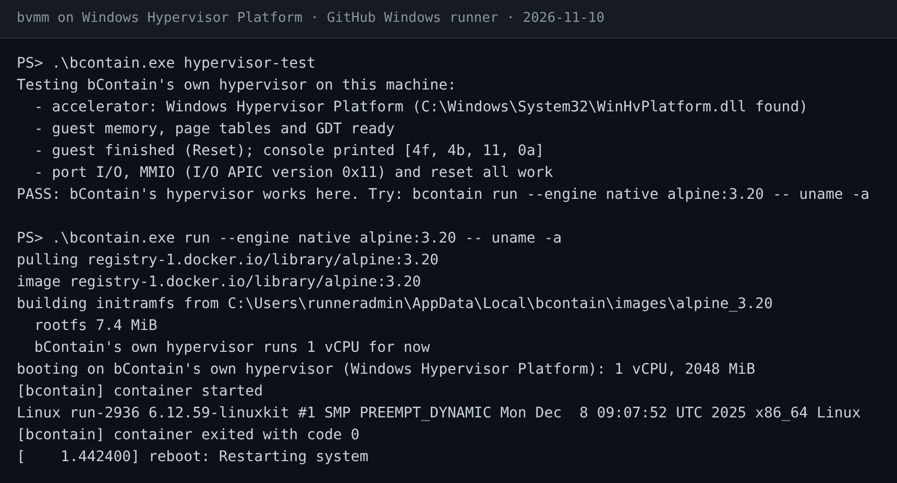

### A disk over PCI, on Windows

Android only accepts its virtual devices on a PCI bus, so the engine now has
one. Here a Linux guest on Windows finds the bus, binds its disk driver, reads
what the host put on the disk and writes something back
([result notes](docs/engine/results/2026-11-10-E1-and-E0b.md)). The same test
passes on Linux.

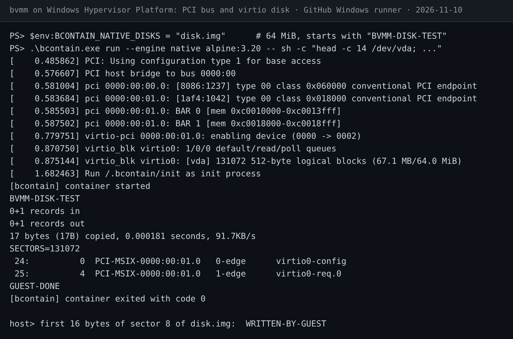

About these images: the text is copied from the CI job logs
(kept beside the images as `.txt` files) and drawn as a terminal picture by
`tools/screenshots/render-terminal.js`. They are faithful renderings of real
output, not photos of a screen. Lines were left out for length (image pull
progress, unrelated kernel messages); none were altered. The disk image's two
command lines at the top and the host read-back line at the bottom are
annotations describing what the test did.

### The reference: the same Android under an existing engine

Before any of that worked, the same image was booted in CI under crosvm, an
existing engine, to learn what Android expects from its machine. This
screenshot was taken from inside the guest on that run.

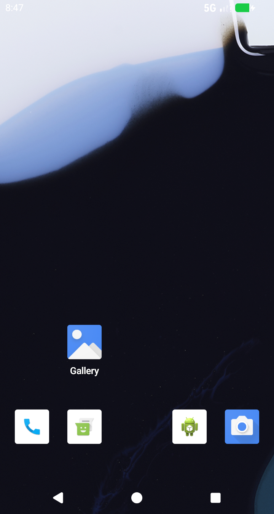

What that run taught us is written up in
[docs/engine/reference](docs/engine/reference/README.md): Android needs its
virtual devices on PCI, its kernel cannot use the Windows timer shortcuts the
engine relied on, and the stock image has no ARM translator.

## How it is meant to work

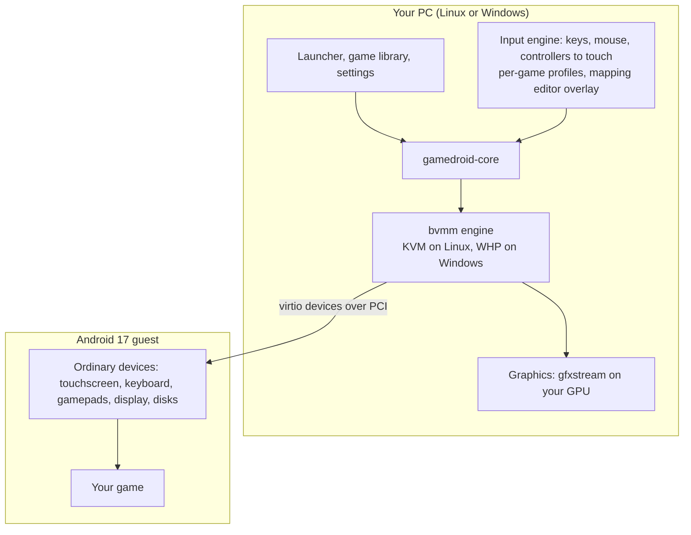

The idea that makes it a gaming emulator: key and controller mapping happens on
the host. Android only ever sees a normal touchscreen and normal gamepads, so
games behave as they would on a phone, and latency stays low.

## Roadmap

Engine milestones, from [docs/engine/ROADMAP.md](docs/engine/ROADMAP.md):

| # | Milestone | State |
|---|---|---|
| E0 | A real Linux kernel boots on KVM and on WHP | Done in CI. Still to repeat on the Intel reference laptop |
| E0b | Android's own kernel boots on both hosts | Done in CI |
| E0c | That kernel gets a precise clock on Windows | Done in CI: the kernel reports `clocksource tsc`. Clean shutdown with it is not yet checked |
| E1 | PCI and a virtio disk | Done in CI on both hosts |
| E2 | Several CPUs and large memory | Done in CI on both hosts (Windows: two processors tried) |
| E3 | ACPI and clean power-off | Planned |
| E4 | Network and vsock | Network done in CI on both hosts: Android is online. vsock services still to come |
| E5 | Android boots | Done in CI on Linux and Windows |
| E6 | A picture | Done in CI on both hosts, to a file; the window is tested without Android only |
| E7 | Touch, keys, gamepad | Touch done in CI on both hosts; keyboard untested; no gamepad device yet |
| E8 | GPU acceleration | The path works in CI on Linux against a software Vulkan ([results](docs/engine/E8-gpu-plan.md)). Windows, a real GPU, and direct presentation are still to do |
| E9 | Sound, microphone, camera | Sound card and camera device: done in CI. Host speakers, microphone and webcam behind them: written in the app, not yet tried on a real machine ([spec and results](docs/engine/E9-sound-camera-spec.md)) |

gameDroid's own features build on these. What is next, in order: try
`gamedroid.exe` on the Windows reference laptop; GPU acceleration, step by
step ([plan](docs/engine/E8-gpu-plan.md)); network and sound in the guest,
which online games and voice chat ([Linphone research](docs/research/linphone.md))
both need; then game mode against a real game.
Performance work needs E8.

## Things worth knowing before you get excited

- **Windows has caught up with Linux in the engine**, in CI: several
  processors and a precise clock. It has still never run on a real Windows
  machine. How the clock was fixed, and the earlier attempt that failed:
  [results](docs/engine/results/2026-11-11-windows-smp-clock.md).
- **It is slow.** Android draws with the CPU, on however many processors the
  host lends. Good enough to prove things work; not good enough to play on.
- **GPU acceleration exists but is unproven where it matters.** Android
  draws through the host renderer in CI on Linux, where the "GPU" is the
  CPU pretending. Nobody has yet seen it on a real GPU, or on Windows.
  Leading with our own engine was a choice; what the other route would
  probably have delivered is recorded as numbered guesses in
  [docs/engine/TRACK1-GUESSES.md](docs/engine/TRACK1-GUESSES.md).
- **Competitive shooters cannot be promised.** Many detect emulators; some ban,
  some put emulator players in their own lobbies. gameDroid will not hide what
  it is or bypass integrity checks. Details in the design plan, section 8.
- **ARM-only games need a translator the stock image does not have.** Google
  apps and ARM translation will be an opt-in step the user performs, offered
  only where the license allows.
- **No custom Android build yet.** There is no build machine for one, so work
  starts from Google's prebuilt Cuttlefish images.

## Try what exists

See the window and the input mapping without Android or a hypervisor, on Linux
or Windows (a test card draws each finger it is sent; F1 switches game mode):

```bash
cargo run --release -p gamedroid -- --demo --profile profiles/example.shooter.toml
```

Check whether a machine is ready (read-only, installs nothing):

```bash
tools/hwtest/probe.sh
```

```powershell
powershell -ExecutionPolicy Bypass -File tools\hwtest\probe.ps1
```

Boot Android in a window, on Linux with KVM or on Windows with the Windows
Hypervisor Platform feature turned on. The first run downloads Android
(1.2 GB) from Google's public build site, after asking where to keep it and
how much room games and their data may use (5 GB free is the least to set up). This
is proven in CI on both hosts, and not yet on a real machine.

```bash
cargo run --release -p gamedroid
```

Prebuilt single files (`gamedroid.exe`, and `gamedroid` for Linux) are the
artifacts of the newest
[package run](https://github.com/inputloop/gameDroid/actions/workflows/package.yml).

The same without a window, saving the screen to a file, as CI does it
([workflow](.github/workflows/engine-android.yml)):

```bash
cargo run --release -p gamedroid-device --bin gamedroid-run -- --setup --screenshot screen.ppm
```

Run the engine on its own, using a [bContain](https://github.com/inputloop/bContain) build:

```bash
bcontain hypervisor-test
```

```bash
bcontain kernel fetch
```

```bash
bcontain run --engine native alpine:3.20 -- uname -a
```

## Repository map

| Path | What is there |
|---|---|
| [docs/DESIGN.md](docs/DESIGN.md) | The design plan: survey of existing emulators, architecture, input design, anti-cheat position, license notes |
| [docs/adr/](docs/adr/) | Decision records |
| [docs/engine/](docs/engine/) | Engine roadmap, results, the Android reference capture, the kept guesses |
| [docs/phase0/](docs/phase0/) | The first round of experiments with existing engines, now closed |
| [docs/screenshots/](docs/screenshots/) | Images used on this page, with their source text |
| [core/input/](core/input/) | gameDroid's input engine (Rust): profiles and the mapping from host controls to touches |
| [app/](app/) | `gamedroid`, the window: shows the guest, sends it mouse and keyboard, game mode from a profile, and a demo mode that needs no Android |
| [core/device/](core/device/) | The virtual Android device (Rust): the machine Android runs in, on the bvmm engine; `gamedroid-run`, a headless runner with scripts that swipe, run shell commands, install and start apps |
| [profiles/](profiles/) | Game profiles. One invented example so far |
| [tools/hwtest/](tools/hwtest/) | Scripts to run on real hardware |
| [tools/engine/](tools/engine/) | Helpers for engine tests: preparing the stock Android image for bvmm (the bootloader's job), screenshot conversion |
| [.github/workflows/](.github/workflows/) | CI: `engine-bvmm` (Linux boot), `engine-disk` (PCI and virtio disk), `engine-gki` (Android's kernel), `engine-smp-mem` (processors and memory), `engine-android` (stock Android on bvmm), `engine-android-oracle` (Android reference capture), `core` (gameDroid's own code), and parked phase 0 jobs. Logs from `engine-android` are published to the `ci-logs` branch |

## How this project is built

One AI coding agent does the building; the owner runs anything that needs real
hardware. The agent has no GPU and no hypervisor of its own, so:

- Anything about booting a VM is proven on GitHub's CI machines, which have
  KVM and the Windows hypervisor.
- Anything about graphics, frame rate or latency is proven only on the owner's
  RTX 3080 Ti laptop, with a result file handed back.
- Every claim in the docs is labelled by how it was checked: read, built, or
  seen running. Guesses are labelled as guesses.

## Keeping this page honest

This README is updated in the same change as anything it describes. Screenshots
are real output or labelled renderings of it; none are mock-ups. If a section
here disagrees with the repository, the repository is right and this page has
a bug.

## License

GPL-3.0-or-later. See [COPYING](COPYING). The engine, bvmm, lives in bContain
under GPL-3.0-or-later OR LGPL-3.0-or-later.
