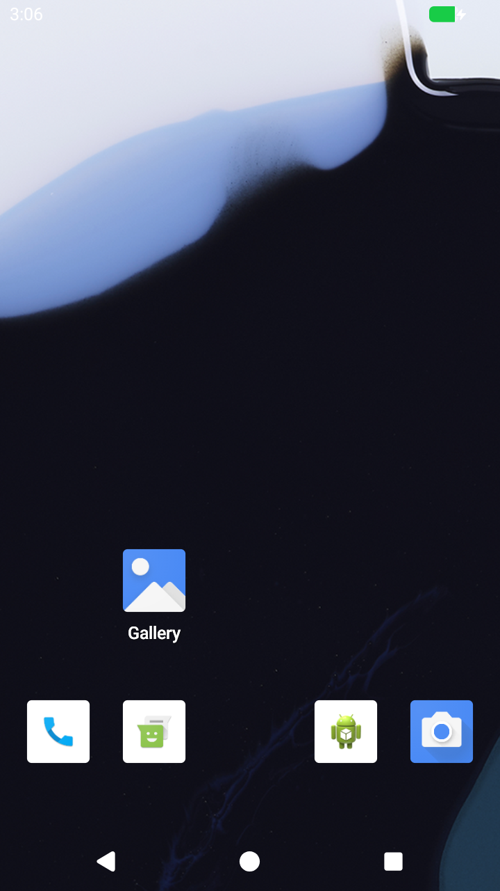
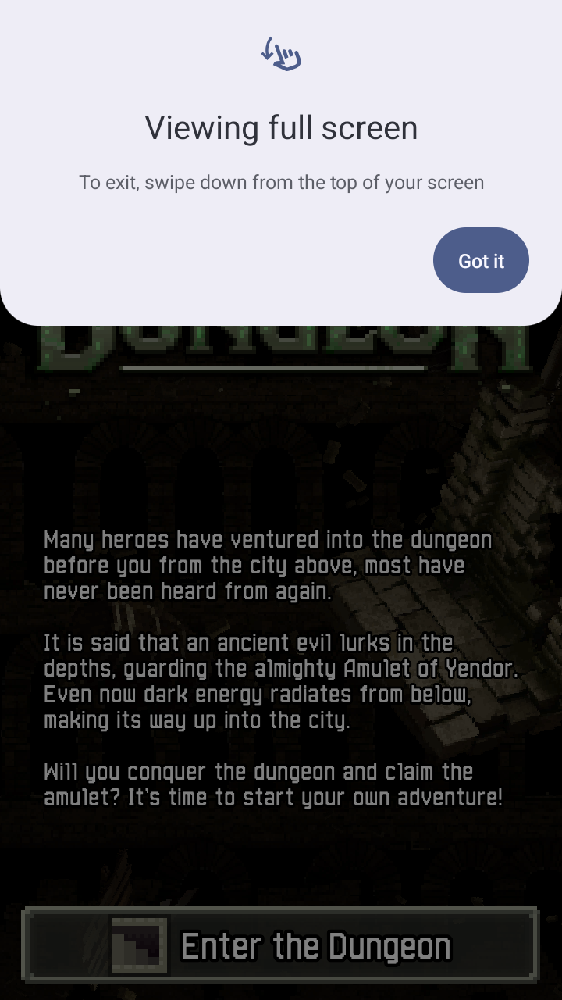

# E8: GPU acceleration, the route

Date: 2026-11-11. Status: plan. Nothing here is built yet.

Confidence: the facts below were read from primary sources by a research
pass on 2026-11-10 (the gfxstream, rutabaga_gfx, crosvm and android-cuttlefish
repositories at their heads). Items marked (inferred) were not confirmed.
Nothing has been built or run.

## Decision

**gfxstream**, reached through the `rutabaga_gfx` Rust crate.

It is the only option with real Windows host support, and Windows is the
platform gameDroid is judged on (ADR 0002).

| Option | Windows host | NVIDIA | Verdict |
|---|---|---|---|
| gfxstream | Yes: documented CMake + ClangCL build, Win32 code paths | Yes | Chosen |
| virglrenderer (virgl GL, Venus) | No, Linux only in practice (inferred) | Venus lists the proprietary driver 570.86+ | Linux only |
| DRM native context | No | No NVIDIA entry in QEMU's host table | Not usable |
| Kumquat | It is a test server, not a product path | Headless only | Not usable |

Licences fit: gfxstream is Apache-2.0, rutabaga_gfx BSD-3-Clause; both may be
combined into a GPLv3+ program.

## What it takes

**On the host**

- `gfxstream_backend` built as a library on Linux (Meson) and Windows
  (CMake, ClangCL). No published Windows binaries were found, so gameDroid
  builds its own in CI at a pinned commit.
- At run time on Windows it needs `libEGL.dll` and `libGLESv2.dll` (the GPU
  vendor's or ANGLE's) and `vulkan-1.dll` (from the driver).
- **Consequence for the single file:** `gamedroid.exe` cannot stay one
  3 MB file. Either it carries the libraries inside itself and unpacks them
  on first run, or it downloads them in setup as it does Android. Still one
  file to start; no longer nothing-but-system-libraries.

**In the engine (bvmm's virtio-gpu, today 2D only)**

- Feature bits VIRGL, RESOURCE_BLOB, CONTEXT_INIT.
- Commands: GET_CAPSET_INFO, GET_CAPSET, CTX_CREATE (with context_init),
  CTX_ATTACH_RESOURCE, CTX_DETACH_RESOURCE, RESOURCE_CREATE_3D,
  TRANSFER_TO_HOST_3D, TRANSFER_FROM_HOST_3D, SUBMIT_3D,
  RESOURCE_CREATE_BLOB, RESOURCE_MAP_BLOB, RESOURCE_UNMAP_BLOB,
  SET_SCANOUT_BLOB.
- Fences completed asynchronously from the renderer's callback, per ring.
- A shared-memory region on the PCI device (a 64-bit BAR) into which host
  memory is mapped for the guest: a KVM memory slot on Linux,
  `WHvMapGpaRange` on Windows. gfxstream's Vulkan needs this; no copy-only
  Vulkan mode was found.
- Capability sets: GFXSTREAM_VULKAN (3), GFXSTREAM_GLES (8),
  GFXSTREAM_COMPOSER (9).

**In the guest image: boot settings only** (from Cuttlefish's
`crosvm_manager.cpp`)

| Setting | Today (guest software) | gfxstream |
|---|---|---|
| `androidboot.hardware.egl` | `angle` | `emulation` |
| `androidboot.hardware.vulkan` | `pastel` | `ranchu` |
| `androidboot.cpuvulkan.version` | Vulkan 1.3 | `0` |
| `androidboot.hardware.gltransport` | (none) | `virtio-gpu-asg` |
| `androidboot.hardware.gralloc` | `minigbm` | `minigbm` |
| `androidboot.opengles.version` | `196609` | `196609` |

The stock image is expected to carry the gfxstream guest libraries already
(inferred; the device makefile could not be fetched to confirm).

**Getting the picture to the window.** gfxstream can present straight into a
native window (`gfxstream_backend_setup_window` with an HWND or X11 window),
or render without a surface and be read back. The first is the fast path and
means the window is no longer drawn by gameDroid from a copied frame.

## Order of work

| Step | What | Proves |
|---|---|---|
| G1 | Build `gfxstream_backend` in CI on Linux and Windows at a pinned commit; publish as artifacts | The Windows build works at all. Biggest unknown |
| G2 | Engine: 3D commands, capability sets, contexts, fences, through rutabaga, on Linux. Software Vulkan on the host (CI has no GPU) | The protocol work |
| G3 | Boot Android with the gfxstream settings; GLES first | The image accepts it |
| G4 | Shared-memory region and blob resources; Vulkan | The memory mapping |
| G5 | The same on Windows: `WHvMapGpaRange`, HWND presentation, packaging the libraries | The product |
| G6 | On the 3080 Ti, both hosts | Real speed. Cannot be done in CI |

## Risks, plainly

- **The Windows build of gfxstream.** Its README still names Visual Studio
  2019. Google exercises it through the emulator and crosvm, not as a
  standalone library. Expect breakage at head.
- **CI has no GPU.** Everything up to G5 can only be proven against a
  software renderer (lavapipe, SwiftShader). Real acceleration is first seen
  on the reference laptop, by hand.
- **Version drift** between rutabaga 0.1.85 and gfxstream's head.
- **NVIDIA quirks** with external memory and synchronisation.
- This is the largest single item on the roadmap. It is several sittings of
  work, not one.

## Sources

- https://github.com/google/gfxstream
- https://github.com/magma-gpu/rutabaga_gfx and https://crates.io/crates/rutabaga_gfx
- https://github.com/google/android-cuttlefish (`base/cvd/cuttlefish/host/libs/vm_manager/crosvm_manager.cpp`)
- https://github.com/google/crosvm
- https://docs.mesa3d.org/drivers/venus.html

## G1 result, 2026-11-11: done

Live-verified in CI (run of gfxstream-build on gameDroid c5a75d5, gfxstream
commit b8537e6d):

| Host | Build | Output |
|---|---|---|
| Linux | Meson | `libgfxstream_backend.so`, 89 MB unstripped |
| Linux | CMake + Ninja | `libgfxstream_backend.so`, 103 MB unstripped |
| Windows | CMake + ClangCL (Visual Studio 2022) | `gfxstream_backend.dll`, 6.7 MB, and a 12.6 MB static library |

The Windows build needed two fixes, both applied by the CI job:

- `WIN32_LEAN_AND_MEAN` defined for the whole build, as gfxstream's Bazel
  build does and its CMake build does not; without it `windows.h` pulls in
  the old `winsock.h` and clashes with `WinSock2.h`.
- A one-line patch to `host/vulkan/vk_common_operations.cpp`: a
  `std::string` passed to a printf-style log call in Windows-only code.
  Worth reporting upstream.

The DLL asks Windows only for system libraries and the Visual C++ runtime
(`MSVCP140.dll`, `VCRUNTIME140.dll`). It loads the GPU's EGL, GLES and
Vulkan libraries at run time, so those are not in that list. A static
library also exists, which leaves open linking gfxstream into
`gamedroid.exe` itself and keeping one file.

Built means compiled and linked. Nothing has loaded or run the library yet.
Next is G2.

## G2a result, 2026-11-11: the library starts, and it settles which mode to use

Live-verified in CI (gfxstream-build on gameDroid 0792e43). The probe
`tools/gpu/probe_gfxstream.py` loads the library we build and starts it as
a VMM would, without a GPU.

| Host | Mode | Result |
|---|---|---|
| Linux (Mesa lavapipe) | Vulkan only | **Starts.** Offers capability sets 3 (Vulkan), 8 (GLES) and 9 (composer); a context is created and destroyed |
| Linux (Mesa llvmpipe) | OpenGL ES on the host | Fails: `Failed to find exactly 1 GLES 2.x config: found 0` |
| Windows runner | OpenGL ES on the host | Fails: `libEGL.dll` and `libGLESv2.dll` not found, then an access violation |
| Windows runner | Vulkan only | Fails: `VK_ERROR_INCOMPATIBLE_DRIVER`. The runner has no Vulkan driver at all |

What this decides:

- **gameDroid will run gfxstream in Vulkan-only mode, with OpenGL ES done
  inside Android by ANGLE on top of that Vulkan.** This is Cuttlefish's
  `gfxstream_guest_angle` mode (`hardware.egl=angle`,
  `hardware.vulkan=ranchu`). The host then needs only a Vulkan driver, which
  the NVIDIA driver supplies on both Windows and Linux. No ANGLE or OpenGL
  ES libraries have to ship beside `gamedroid.exe`.
- The price: Vulkan needs host memory mapped into the guest, so the
  shared-memory work planned as G4 cannot be put off. Steps G2 to G4 merge
  into one: the 3D protocol, blob resources and the memory mapping together.
- **Windows cannot be tested in CI as it stands.** The runner has no Vulkan
  driver. A software Vulkan for Windows (Mesa's lavapipe or SwiftShader)
  has to be added to the CI job, for testing only.

Two things to guard against, seen here:

- A failed start does not return an error: the library hangs (the probe's
  child processes timed out) or crashes. gameDroid must start it in a way
  that a failure falls back to today's software rendering instead of taking
  the emulator down. A separate process, or a check before loading.
- The OpenGL ES failure on Linux was not investigated, since that mode is
  not being used.

Revised order:

| Step | What | State |
|---|---|---|
| G1 | Build the library on both hosts | Done |
| G2a | Start it without a GPU | Done on Linux; Windows needs a software Vulkan in CI |
| G2 | Engine: 3D commands, capability sets, contexts, fences, blob resources, and the shared-memory region mapped into the guest (KVM first) | Next |
| G3 | Boot Android in guest-ANGLE mode on Linux; the picture read back into the existing window | |
| G4 | The same on Windows (`WHvMapGpaRange`), with a software Vulkan in CI | |
| G5 | Present straight into the window instead of reading back | |
| G6 | On the 3080 Ti, both hosts | Cannot be done in CI |

## G2 and G3 result, 2026-11-11: Android draws through gfxstream on Linux

Live-verified in CI (gfxstream-build on gameDroid 3fc20f0, bContain
989af02), against Mesa's software Vulkan, since the runner has no GPU.

Android's own account of who is drawing:

    ro.hardware.vulkan: ranchu
    GLES: Google Inc. (Mesa), ANGLE (Mesa, Vulkan 1.3.275 (Virtio-GPU
    GFXStream (llvmpipe (LLVM 20.1.2 256 bits))), ...), OpenGL ES 3.2

And the guest kernel's view of the device:

    [drm] Host memory window: 0xa000000000 +0x200000000
    [drm] features: +virgl -edid +resource_blob +host_visible
    [drm] features: +context_init
    [drm] cap set 0: id 3, max-version 0, max-size 116
    [drm] cap set 1: id 9, max-version 0, max-size 16

Android booted in 34 s of guest time, unlocked by touch, went online,
installed Shattered Pixel Dungeon and brought it to the front; the same
script and checks as the software-rendering job. Frames reached the
existing window path by reading each one back from the renderer.

 

What was built:

- **Engine (bContain `crates/bvmm`):** `gfxstream.rs`, the binding to the
  library, loaded at run time; `virtio/gpu3d.rs`, the display device
  (capability sets, contexts, command buffers, 3D resources, fences, blob
  resources); a shared-memory window on the PCI device; and a `Mapper` that
  places host memory in the running guest (memory slots on KVM,
  `WHvMapGpaRange` on Windows).
- **gameDroid:** boot settings for the mode, carried in a second initrd;
  `gamedroid-run --gpu <library>`; `gamedroid-gpu-check`.

What this does and does not show:

- It shows the whole path is correct: protocol, fences, memory mapping,
  readback. It worked on the first boot.
- **It says nothing about speed.** The "GPU" in CI is the CPU pretending,
  and every frame is copied back. Real acceleration is first seen on a
  machine with a GPU.
- The Windows half (`WHvMapGpaRange`) is written and compiles; it has never
  run. CI's Windows runner has no Vulkan driver.
- The windowed app (`gamedroid`) has no way to turn this on yet; only the
  headless runner does.

One fault found on the way: frames from the renderer came out with red and
blue swapped, because gameDroid was applying the correction it needs for
frames Android draws with the CPU. The correction is now applied only
there.

Remaining:

| Step | What | State |
|---|---|---|
| G4 | The same on Windows | Code written; needs a Vulkan driver to run. In CI that means a software Vulkan; on the laptop, the NVIDIA driver |
| G5 | Present straight into the window, no readback | Not started |
| G6 | On the 3080 Ti, both hosts | The first real measurement |
| | Turn it on from the app, with the check-first guard, and ship the library with `gamedroid.exe` | Not started |

## Turned on by itself, 2026-11-11

Live-verified in CI on Linux (app-android on gameDroid d46989a): the
windowed app, started with no arguments, carried the gfxstream library
inside itself, unpacked it, tried it in a separate process against a
software Vulkan, chose the graphics card, and Android booted, with the
browser set up and F3 working as before.

How the choice is made (`core/device/src/gpu.rs`):

1. Find the library: the one `GAMEDROID_GFXSTREAM` names, one beside the
   program, or gameDroid's own copy (unpacked from inside the program when
   it was built carrying one; the package jobs do that).
2. If the last start with the graphics card never finished booting, leave
   it alone and say so. `--gpu on` tries again.
3. Start gameDroid again as a separate process just to start the renderer.
   If that fails, hangs past 40 seconds or crashes: draw with the
   processor, and say why.
4. Otherwise draw with the graphics card.

`--gpu off` never uses it; `--gpu on` treats a failed check as an error.

Still unverified: the fallback on Windows (the run is in CI as this is
written), and everything on a real GPU.
