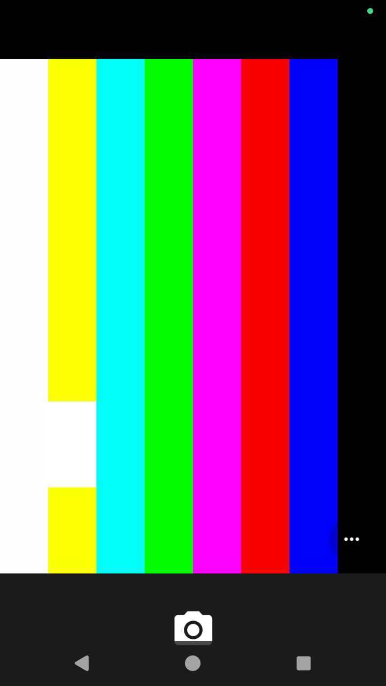

# E9: sound, microphone and camera, the route

Date: 2026-11-11. Status: specification. Nothing here is built yet.

Confidence: read from source by a research pass on 2026-11-11 unless marked
(inferred). Sources: Linux v6.12 `sound/virtio` and `virtio_snd.h`; mirrors
of Android 17's `device/google/cuttlefish` and `hardware/interfaces` (not
the exact stock tag); android-cuttlefish and crosvm host code; the
virtio-media driver. Nothing has been run.

## Decision

- **Sound out and microphone:** a virtio-snd device in the engine, with the
  host's default output and input devices behind it through the `cpal`
  crate (Apache-2.0; WASAPI on Windows with no C libraries, ALSA on Linux).
- **Camera:** a virtio-media device in the engine presenting one V4L2
  capture device, with the image booted on its V4L2 camera variant. This is
  Cuttlefish's own supported path for a host webcam.

Sound comes first: it is smaller, games need it, and Linphone needs both
directions.

## Sound: what the stock image expects

- Android's audio is the default AIDL audio service, using tinyalsa on
  **sound card 0, device 0**, for both directions. There is no setting that
  selects another.
- With no sound card and no stub settings, opening a stream fails. The stub
  settings are `androidboot.audio.tinyalsa.ignore_output=true` and
  `androidboot.audio.tinyalsa.simulate_input=true`. **gameDroid sets neither
  today, so Android's audio is currently failing to open**; until the device
  exists these two should be set.
- `virtio_snd.ko` is among the image's kernel modules. So is `snd-aloop.ko`,
  which might take card 0 first (inferred): check `/proc/asound/cards`.
- One playback and one capture stream are opened. 16-bit samples; rates
  8000, 11025, 16000, 32000, 44100, 48000; mono or stereo.
- Buffer: 85 ms rounded up, four periods. At 48 kHz stereo: 4096 frames in
  the buffer, 1024 per period (4096 bytes, 21.3 ms).

## virtio-snd as Linux 6.12 requires it

Device id 25. No feature bits needed. Queues: 0 control, 1 event, 2 tx
(playback), 3 rx (capture).

Configuration, little-endian u32 each: jacks, streams, chmaps, controls.
The minimal device: jacks 0, streams 2, chmaps 0 (controls unread).

**Control requests.** The request is device-readable; the answer starts
with a u32 status, then any data. Status: OK 0x8000, BAD_MSG 0x8001,
NOT_SUPP 0x8002, IO_ERR 0x8003. The driver waits 1 s for an answer.

| Request | Code | Layout |
|---|---|---|
| PCM_INFO | 0x100 | `{code, start_id, count, size}`; answer: status, then `count` records of `size` bytes |
| PCM_SET_PARAMS | 0x101 | `{code, stream_id, buffer_bytes, period_bytes, features, u8 channels, u8 format, u8 rate, u8 pad}` (24 bytes) |
| PCM_PREPARE | 0x102 | `{code, stream_id}` |
| PCM_RELEASE | 0x103 | `{code, stream_id}` |
| PCM_START | 0x104 | `{code, stream_id}` |
| PCM_STOP | 0x105 | `{code, stream_id}` |

`pcm_info` (32 bytes): hda_fn_nid u32, features u32, formats u64, rates u64,
direction u8 (0 output, 1 input), channels_min u8, channels_max u8, pad[5].

Both streams must have `hda_fn_nid` 0: it becomes the ALSA device number,
and Android opens device 0 for both directions.

Advertise: stream 0 output, stream 1 input; formats `0x20` (S16, bit 5);
rates `0xEE` (8000 bit 1, 11025 bit 2, 16000 bit 3, 32000 bit 5, 44100
bit 6, 48000 bit 7); channels 1 to 2; features 0. In SET_PARAMS the format
and rate are those bit numbers, not masks.

**Playback (tx).** Each buffer: device-readable `{stream_id u32}` then
exactly one period of samples; device-writable `{status u32, latency_bytes
u32}`.

**Capture (rx).** Each buffer: device-readable `{stream_id u32}`;
device-writable one period of samples, then `{status, latency_bytes}` last.
The used length is the samples plus 8.

**The device is the clock.** The guest's position advances only when a
buffer is returned. Return one playback buffer per period of real time, as
the host consumes it, and one capture buffer per period captured. Returning
at once makes playback run fast.

**On RELEASE, hand back every pending buffer.** The driver waits 1 s for
them and reports an error otherwise. Capture queues all its buffers before
START. Events are not needed.

Worth copying from crosvm: the host stream's callback as the clock; silence
on underrun; an absolute-deadline timer when there is no host device, so
there is no drift; a ring buffer and resampler between the guest's period
and the host's callback; a silent stand-in when the host has no device.

## Host sound

`cpal` 0.18: enumerate with `host.input_devices()`, default with
`default_input_device()`. Streams are callbacks, so a ring buffer sits
between them and the device. Linux builds need `libasound2-dev`. Resample
with `rubato` if the host's rate differs.

Several microphones: the guest sees one input stream; which host microphone
feeds it is a gameDroid setting.

## Camera: what the stock image offers

- Two variants of one camera package are in the image: the default
  **emulated camera** (a synthetic scene; no way to feed it frames) and a
  **V4L2 variant** holding Android's reference external-camera provider.
- Selected with
  `androidboot.vendor.apex.com.google.emulated.camera.provider.hal =
  com.google.emulated.camera.provider.hal.v4l2`. Choosing it removes the
  synthetic cameras.
- That provider watches `/dev/video*`, needs a capture device, and accepts
  only **MJPEG** (and a depth format). It uses memory-mapped buffers and the
  ioctls QUERYCAP, ENUM_FMT, ENUM_FRAMESIZES, ENUM_FRAMEINTERVALS, S_FMT,
  G_PARM, S_PARM, REQBUFS, QUERYBUF, QBUF, DQBUF, STREAMON, STREAMOFF.
- The image's kernel modules include `virtio-media.ko` (not in mainline).
- **To confirm on the image before building:** that the `.v4l2` variant and
  `virtio-media.ko` are really present in this build (the variant was added
  to the source in March 2026). Without them no route works short of
  rebuilding the image.
- The camera will appear to apps as an *external* camera, which some apps
  ignore (inferred).

## virtio-media

Device id 48. Queues: 0 command, 1 event. Configuration: device_caps u32,
device_type u32 (0: video), card[32]. Shared-memory region 0 holds the
frame buffers (the engine's shared-memory window and Mapper, built for the
GPU, serve here too).

Commands, header `{cmd u32, reserved u32}`, answer `{status u32 (errno),
reserved u32}`:

| Command | Code | Layout |
|---|---|---|
| OPEN | 1 | answer adds `{session_id, reserved}` |
| CLOSE | 2 | `{session_id, reserved}` |
| IOCTL | 3 | `{session_id, code}` (the ioctl's number); the 64-bit V4L2 struct follows the command for a write, the answer for a read, or both |
| MMAP | 4 | `{session_id, flags, offset}`; answer `{driver_addr u64 (offset in the window), len u64}` |
| MUNMAP | 5 | `{driver_addr u64}` |

Events, header `{event u32, session_id u32}`: ERROR 0, DQBUF 1 (a
`v4l2_buffer` and planes), EVENT 2. Finished frames arrive as DQBUF events,
not as answers to an ioctl.

## Host camera

`nokhwa` (Apache-2.0): Media Foundation on Windows, V4L2 on Linux. Ask the
camera for MJPEG and pass frames through undecoded where it offers them;
otherwise encode with `jpeg-encoder` (pure Rust).

## Order of work

| Step | What | Proves |
|---|---|---|
| S0 | Set the two stub settings; confirm in CI what `/proc/asound/cards` and the camera package variants really are on this image | The facts above that are inferred |
| S1 | virtio-snd in the engine with a silent, clocked stand-in behind it; Android plays and records without errors | The protocol and the pacing |
| S2 | Host output through cpal: sound from a game | Playback |
| S3 | Host microphone through cpal, with a setting for which one | Capture; Linphone can make a call |
| C1 | virtio-media in the engine with a test-pattern MJPEG source; Android's camera app shows it | The protocol |
| C2 | Host webcam through nokhwa, with a setting for which one | The camera |

CI has neither a sound device nor a camera, so S2, S3 and C2 can only be
proven there with stand-ins. Real devices are first heard and seen on a
real machine.

## S1 result, 2026-11-11: Android has a sound card

Live-verified in CI on Linux (engine-android on gameDroid 326a447, bContain
b47fa89):

     0 [SoundCard      ]: virtio-snd - VirtIO SoundCard
    00-00: virtio-snd : VirtIO PCM 0 : playback 1 : capture 1
    Output thread ..., name AudioOut_D ... Sample rate: 48000 Hz
    gameDroid: Android is playing sound (48000 Hz, 2 channel(s))
    gameDroid: Android stopped playing (2818048 bytes of sound)

The engine's virtio-snd device is card 0 (the loopback module did not take
its place), Android's audio service opened it at 48 kHz stereo, and Android
played into it: system sounds and then the game's, megabytes at a time.
The earlier inference that Android's audio had been failing without a card
was not checked directly.

## S2 and S3, 2026-11-11: written, not yet heard

The windowed app now puts the host's default speakers and a microphone
behind the card (`app/src/audio.rs`, using cpal 0.15): a short queue of
samples between Android's pace and the host device's, converting rate and
channels as sound leaves it. The microphone is opened only while Android is
recording, and closed when it stops. `--microphone <part of its name>`
chooses one; `--list-microphones` prints them.

Verified: the queue and conversion, by unit tests. **Not verified: any
sound through a real device.** CI machines have none. The headless runner
keeps its metering stand-in.

Known weakness: Android's card keeps time by the computer's clock and the
host's sound device by its own. They drift apart slowly; the queue absorbs
it by dropping its oldest sound when it grows past a quarter of a second,
which may be heard as an occasional click. A proper fix follows the host
device's clock.

`/dev/video0` already exists in the stock guest (owned by system:camera),
before any camera work. What provides it has not been established.

## C1 result, 2026-11-11: Android has a camera

Live-verified in CI on Linux (engine-android on gameDroid d46989a, bContain
c01474f).

    /sys/class/video4linux/video1 virtio-media
    Number of camera devices: 1
    == Camera Provider HAL ...ICameraProvider/external/0-0 ... 1 devices
    gameDroid: Android started the camera (640x480, 30 frames a second)
    gameDroid: Android stopped the camera after 285 frames

The engine's virtio-media device appears as `/dev/video1`, the image's V4L2
camera service takes it as Android's one camera, and Android's own camera
app shows its picture: the test picture's colour bars, with the block that
moves.

Answers to what was open:

- `/dev/video0`, there before any of this, is the kernel's "Dummy video
  device" (the loopback module). Android's camera service ignores it.
- Android reports the camera as facing **front**, not as an external
  camera, so apps that want a front camera will find it.
- The image does contain the V4L2 camera variant and `virtio-media.ko`.

Two things found on the way, both in the engine:

- The machine reached 32 devices and the PCI bus held 31. It now takes up
  to 248, without moving the first 31.
- Shared-memory windows started at 512 GiB, beyond the 39-bit addresses of
  ordinary desktop and laptop processors. The GPU's window would have
  failed on such a machine. They now start at 64 GiB.

Not done: a real webcam behind it (C2). The test picture is all Android
can see so far.

## C2, 2026-11-11: written, not yet seen

The windowed app puts a webcam behind Android's camera (`core/webcam`,
`app/src/camera.rs`). Linux: V4L2 spoken directly, no library. Windows:
Media Foundation through `nokhwa` 0.10. JPEG from the camera passes through;
YUYV and NV12 are encoded. The webcam is opened when Android starts its
camera and closed when it stops. With no webcam, or one that cannot give
exactly the size Android asked for (640x480 or 1280x720), Android sees the
test picture and the reason is printed.

Verified: choosing a camera, the conversions, the hand-over, the V4L2
request numbers against the kernel's; and that it compiles for both
systems. **Not verified: any picture from a real webcam.** CI has none.

Known gaps: a webcam offering neither of those two sizes is not used (its
picture is not rescaled); the Windows path has never run at all.
