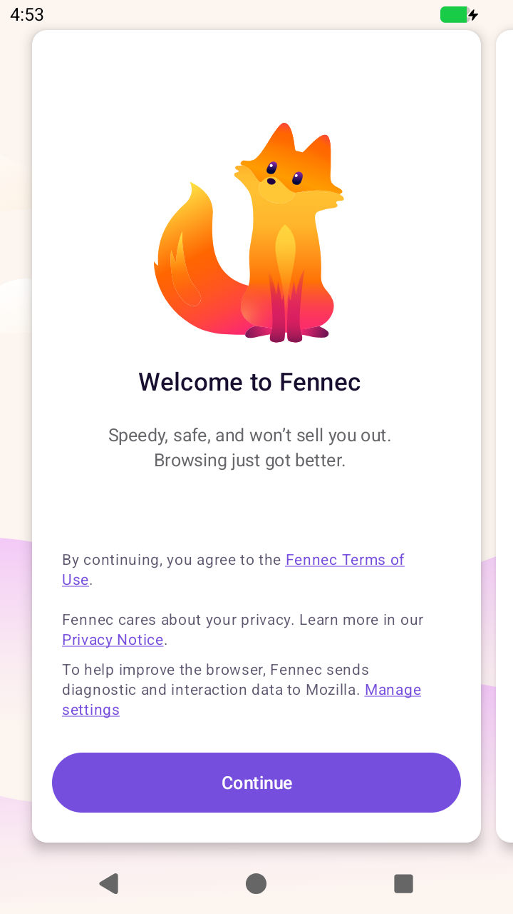

# Firefox and gameDroid

Date: 2026-11-11. Status: looked into; one experiment run. A decision is
needed before more is built.

## What was tried

Live-verified in CI on Linux (the `firefox` workflow, gameDroid a60088f).

"Fennec F-Droid" (`org.mozilla.fennec_fdroid`) is F-Droid's own build of
Firefox for Android from Mozilla's source, under the MPL-2.0, with Mozilla's
proprietary parts and trademarks taken out; hence the name. F-Droid
publishes it once per processor kind. The newest release was version code
1590120 for ARM and **1590110 for x86-64**, which is the one gameDroid's
Android can run.

That APK (134 MB) installed on gameDroid, started, and was the front
activity, using about 226 MB of memory at its welcome screen, with no crash
in the log:

Not tried: anything past the welcome screen (loading a page, video, sound,
the camera or microphone in a page, add-ons).

## What is known about making it fit

- **Its home page cannot be set to gameDroid's help page.** Firefox for
  Android has no setting for a home page address (inferred from its
  settings, not verified in source). The help page could still be opened in
  it on request.
- **It is large.** 134 MB to download against Fulguris's 9 MB, and it
  brings its own browser engine where Fulguris uses Android's.
- **Its welcome screen says it "sends diagnostic and interaction data to
  Mozilla"**, with a link to manage that. F-Droid's build is meant to have
  telemetry off; whether this text is only left-over wording was not
  checked. It should be, before gameDroid installs it for anyone unasked.
- **Why one might want it anyway:** a full, current browser engine; add-ons
  (an ad blocker, say); and it does not depend on the image's WebView,
  which is whatever version Google's build happened to ship.
- The official Mozilla build also exists for x86-64, but carries Google's
  services and Mozilla's trademarks; gameDroid ships free software only.

## Ways to integrate it

| Option | What the person gets | Cost |
|---|---|---|
| **A. Offered, not installed.** gameDroid installs Fennec when asked (a command now, a button in a launcher later), beside Fulguris | A choice; nothing extra downloaded unless wanted | Small: the fetch-and-install path already exists for Fulguris |
| **B. Installed by default, beside Fulguris**, Fulguris staying the default browser with the help page | Both browsers there from the first start | 134 MB more on every first run |
| **C. Fennec replaces Fulguris** as the browser gameDroid sets up | One browser, the best-known one | The help page can no longer be the start page; 134 MB; the telemetry question must be settled first |

## Recommendation

**A.** It costs almost nothing to build, keeps the first run small, and
keeps the help page where it is. If Firefox turns out to be what people
reach for, B is one line away.

**The question for the owner:** A, B or C.

## Decision and outcome (2026-11-13)

The owner chose **C**: Fennec replaces Fulguris. What was then settled:

- **Telemetry (read in source, not measured on the wire).** F-Droid's
  build recipe turns the telemetry and crash-reporting build flags off and
  patches the settings to fixed "off" values; the libraries for Adjust,
  Firebase and Play are replaced by empty stand-ins. The sentence on the
  welcome screen is the ordinary Firefox's text, left in. F-Droid itself
  still lists the app as connecting to "various Mozilla services".
  gameDroid therefore skips the welcome screens rather than show a
  sentence that is untrue of this build.
- **Start page.** Firefox for Android has no home-page address, and
  refuses `file:` addresses everywhere (address bar and intents alike);
  `content:` is allowed for PDFs only. So the help page is served by the
  machine's gateway at `http://10.0.2.2/help.html` (bvmm's NAT serves
  fixed pages), shown as Firefox's first page, and Firefox is set to open
  on its last page. Closing that tab loses it as the opening page; F3
  brings it back.
- **A surprise (live, CI).** Android 17 asks before an app may reach a
  local-network address, and 10.0.2.2 is one: Firefox showed "Allow Fennec
  to find, connect to ... nearby devices?" in place of the page. gameDroid
  grants that permission at setup.
- **Verified live in CI (Linux):** installed from the fixed file, default
  browser, no welcome screens, help page shown, and shown again after the
  browser is stopped and started from its icon.
- **Not verified:** video playback and WebGL in it; the same on Windows;
  what it actually sends on the wire. A one-time hint bubble ("Shake your
  device to summarize this page") still appears on the first page.
- No DRM module (Widevine) in this build: copy-protected video sites will
  not play.
