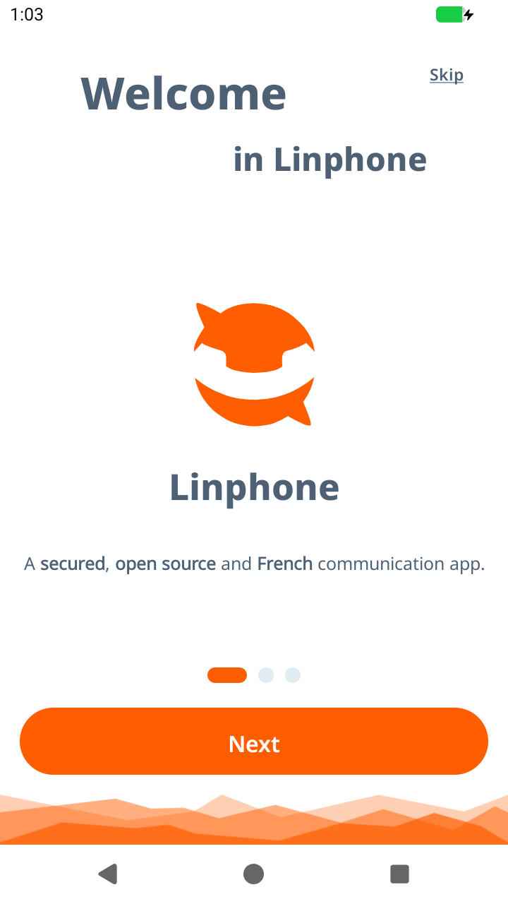

# Linphone and gameDroid

Date: 2026-11-11. Status: **decided, option A** (see the end). First experiment in CI.

Confidence: read from Linphone's own repositories and F-Droid's build recipe
by a research pass on 2026-11-10. Items marked (inferred) were not confirmed.
f-droid.org and download.linphone.org could not be reached, so F-Droid facts
come from the recipe in fdroiddata.

## What Linphone is

A free SIP voice and video calling suite from Belledonne Communications.

| Part | What | Licence |
|---|---|---|
| linphone-android | The Android app, `org.linphone` | GPLv3 (or paid) |
| linphone-sdk | liblinphone, mediastreamer2, oRTP, belle-sip and more | AGPLv3 (or paid); "the usual GPLv3 terms apply" to client products |
| flexisip | The SIP server | AGPLv3 |

A GPLv3+ project may bundle or link these (inferred from GPLv3 section 13);
a binary that links the AGPL parts is then under GPLv3/AGPLv3 together.

## The blocker for the simple route

**The F-Droid build of Linphone is ARM only** (`arm64-v8a`), and upstream's
own builds are ARM only too. gameDroid's Android image is x86-64 with no ARM
translator, so that APK will not run. The SDK does support building for
x86-64, so a build of our own is possible.

The app needs Android 9 or later (fine), and works without Google services
if it is kept running (inferred; F-Droid strips Firebase).

## What it needs from the emulator that is missing today

| Need | State in gameDroid |
|---|---|
| Network in the guest (virtio-net, with host-side NAT) | Missing. Roadmap E4 |
| Sound out (virtio-snd playback) | Missing. Roadmap E9 |
| Microphone (virtio-snd capture) | Missing |
| Camera | Missing; optional for Linphone |

Without network Linphone cannot register; without sound a call is silent.
Every online game needs the first two anyway.

## Three things "integrating Linphone" could mean

| Option | For | Against | Needs |
|---|---|---|---|
| **A. Linphone as an app inside Android**, offered by gameDroid | No licence entanglement in our code; ordinary Android behaviour | We must build an x86-64 APK ourselves and keep it current | Network, sound and microphone devices; an APK build |
| **B. Voice chat on the host**, built into gameDroid with liblinphone | Works whatever Android is doing; no guest devices needed | A very large C/C++ dependency with no Rust bindings; AGPL parts inside `gamedroid.exe`; needs a SIP server from somewhere | FFI bindings, a CMake build on both hosts, an overlay, an account system |
| **C. Linphone's media stack (mediastreamer2) as gameDroid's sound path** | Mature echo cancelling and codecs | Far more than bridging a sound device needs | The same build burden as B |

## Recommendation

**A**, and in this order: network (E4), then sound and microphone (E9),
which games need regardless; then an x86-64 build of the Linphone APK that
gameDroid can offer to install. B only if the aim is voice chat between
gameDroid players that works outside any one game, which is a product
decision, not an engineering one.

## Decision

2026-11-11, by the owner: **A. Linphone as an app inside Android that
gameDroid offers to install.**

What that commits to, in order:

| Step | What | State |
|---|---|---|
| L1 | Build the app for x86-64 from its source; see it install and start on gameDroid | **Done in CI, 2026-11-11** (below) |
| L2 | Network in the guest (roadmap E4) | **Done in CI, 2026-11-11** (`docs/engine/results/2026-11-11-network.md`). Linphone itself has not been tried on it yet |
| L3 | Sound out and microphone in the guest (roadmap E9) | Not started |
| L4 | A call between two Linphone instances, heard and spoken | Needs L2 and L3 |
| L5 | gameDroid offers to install it, from a build gameDroid publishes with its source | Needs L1; licence notes to write |

## Sources

- https://github.com/BelledonneCommunications/linphone-sdk
- https://github.com/BelledonneCommunications/linphone-android (`app/build.gradle.kts`, `AndroidManifest.xml`)
- https://gitlab.com/fdroid/fdroiddata/-/raw/master/metadata/org.linphone.yml
- https://linphone.org/en/liblinphone-voip-sdk

## L1 result, 2026-11-11

Live-verified in CI (gameDroid f15bc01, linphone-android 92318a2 of
2026-11-09, Linphone SDK 5.6.0-alpha.219).

Changing one line of the app's build file, the list of processor kinds from
the two ARM ones to `x86_64`, is enough: Belledonne's published SDK already
contains x86-64 native code, so nothing native had to be built. The
resulting APK (115 MB, debug build) holds 15 x86-64 libraries, installs on
gameDroid, starts, and is the front activity, with no crash in the log:

Not tested: anything past the welcome screen. Registering needs a network.

Two things to settle before gameDroid offers this build to anyone (L5):

- **The build picked up Firebase.** The repository ships a
  `google-services.json`, so this build includes Google's proprietary
  messaging library. A build gameDroid publishes should leave it out, as
  F-Droid's does.
- **It is a debug build, signed with a throwaway key,** from the tip of the
  development branch. A published build should come from a release tag and
  carry a key gameDroid keeps.
